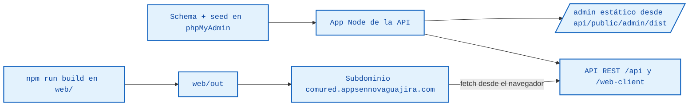

# Proceso de despliegue — Comured

Guía paso a paso para desplegar la plataforma en Hostinger (plan Cloud Startup).

## 0. Requisitos previos

- Cuenta Hostinger con plan Cloud Startup activo.
- Acceso a hPanel, phpMyAdmin y el terminal SSH del plan.
- Repositorio `https://github.com/Alexhumme/guajira-platform` actualizado (rama `main`).

## 0.5 Scripts de la raíz del proyecto

Todos los comandos se ejecutan desde la raíz del monorepo (carpeta que contiene `package.json` raíz):

| Comando | Descripción |
|---|---|
| `npm run upload` | Compila e sube `web/` y `admin-react/` por SFTP a Hostinger |
| `npm run upload -- web` | Solo frontend: `npm run build` en `web/` + subida de `web/out/` |
| `npm run upload -- admin` | Solo panel: `npm run build` en `admin-react/` + subida de `api/public/admin/dist/` |
| `npm run ssh` | Abre una shell SSH interactiva en el servidor |
| `npm run ssh -- "<comando>"` | Ejecuta un comando remoto puntual y devuelve su salida |

Variables de entorno necesarias para estos scripts (en el `.env` raíz, ver `.env.example`):

| Variable | Descripción | Ejemplo |
|---|---|---|
| `SSH_IP` | IP del servidor donde está el hosting | `123.45.67.89` |
| `SSH_PORT` | Puerto SSH | `65002` |
| `SSH_USERNAME` | Usuario SSH del hosting | `u610022487` |
| `SSH_PASSWORD` | Contraseña SSH | `********` |

## 0.6 Variables de entorno por archivo

Completa las siguientes tablas con los valores reales de tu entorno de producción antes del primer despliegue.

### `.env` raíz (scripts de upload/ssh)

| Variable | Valor de producción |
|---|---|
| `SSH_IP` |  |
| `SSH_PORT` |  |
| `SSH_USERNAME` |  |
| `SSH_PASSWORD` |  |

### `api/.env`

| Variable | Valor de producción |
|---|---|
| `DB_HOST` |  |
| `DB_USER` |  |
| `DB_PASSWORD` |  |
| `DB_NAME` | `comured` |
| `DB_PORT` | `3306` |
| `PORT` | `5000` |
| `NODE_ENV` | `production` |
| `SESSION_SECRET` |  |
| `ADMIN_BOOTSTRAP_USER` | `admin` |
| `ADMIN_BOOTSTRAP_PASSWORD` |  |
| `CORS_ORIGINS` | `https://comured.appsennovaguajira.com` |
| `MAX_FILE_SIZE` | `10MB` |

### `web/.env`

| Variable | Valor de producción |
|---|---|
| `NEXT_PUBLIC_API_URL` |  |

### `admin-react/.env`

| Variable | Valor de producción |
|---|---|
| `VITE_API_BASE` | `` (vacío: el admin se sirve desde el mismo dominio/subdominio configurado como base) |

## 1. Base de datos

1. En hPanel → Bases de datos MySQL, crear la base `comured` (charset `utf8mb4`).
2. En phpMyAdmin, importar en orden:
   - `api/sql/schema.sql` (estructura)
   - `api/sql/seed.sql` (datos iniciales)
3. Anotar usuario, contraseña, host (normalmente `localhost`) y puerto `3306`.

## 2. API (backend Node.js)

1. hPanel → Websites → **Node.js Apps** → agregar aplicación desde GitHub (o subir archivos por FTP).
2. Configuración:
   - **Directorio raíz**: `api/`
   - **Comando de inicio**: `node server.js` (o `npm start`)
   - **Versión de Node**: 20.x (o 22.x)
3. Variables de entorno (en el panel de la app, sin subir `.env`):

```
DB_HOST=localhost
DB_USER=<usuario>
DB_PASSWORD=<password>
DB_NAME=comured
DB_PORT=3306
PORT=5000
NODE_ENV=production
SESSION_SECRET=<cadena_aleatoria_larga>
ADMIN_BOOTSTRAP_USER=admin
ADMIN_BOOTSTRAP_PASSWORD=<clave_fuerte>
CORS_ORIGINS=https://comured.appsennovaguajira.com
MAX_FILE_SIZE=10MB
```

4. Deploy. Verificar `https://<dominio-api>/` → debe responder la vista estática, `/admin` → panel, `/web-client/municipios` → JSON.
5. Importante: **no borrar `api/public/uploads/`** en redespliegues; es donde quedan los archivos subidos.

## 3. Frontend web (sitio estático)

1. En local, definir `NEXT_PUBLIC_API_URL=https://<dominio-api>` en `web/.env`.
2. Ejecutar `npm run build` en `web/` → genera `web/out/`.
3. Subir el contenido de `web/out/` al document root del subdominio: `domains/appsennovaguajira.com/public_html/comured/`.
4. Verificar que `/comunidades`, `/marketplace`, `/publicaciones`, `/proyecto` carguen y que el navegador pueda llamar a la API (CORS).

### Desplegar vía script (recomendado)

1. Configurar `.env` raíz (ver `.env.example`): `SSH_IP`, `SSH_PORT`, `SSH_USERNAME`, `SSH_PASSWORD`.
2. Asegurar `web/.env` con `NEXT_PUBLIC_API_URL=https://api-comured.appsennovaguajira.com` (o el dominio real de la API).
3. Ejecutar desde la raíz del proyecto:

```bash
npm run upload -- web    # solo web
npm run upload -- admin  # solo admin
npm run upload           # ambos
```

El script construye, crea el directorio remoto si falta y muestra una barra de progreso de la subida SFTP a `domains/appsennovaguajira.com/public_html/{comured,admin_comured}`.

## 4. Panel de administración (estático)

1. `npm run upload -- admin` compila `admin-react` y sube `api/public/admin/dist` a `domains/appsennovaguajira.com/public_html/admin_comured/`.
2. Debe servirse en un subdominio/ruta propio, e.g. `https://admin_comured.appsennovaguajira.com` (document root `public_html/admin_comured`).
3. Verificar que carga y permite login contra la API.

> Nota: el panel compila con `VITE_BASE=/`, por lo que debe estar servido desde la raíz de ese subdominio, no bajo `/admin`.

## 5. Post-despliegue

- Crear el primer administrador con `POST /api/auth/bootstrap` (usuario y clave de `ADMIN_BOOTSTRAP_*`), luego cambiar la clave.
- Rotar `SESSION_SECRET` y credenciales por defecto.
- Verificar login del panel y que las imágenes de `/uploads/...` se vean en el sitio.
- Configurar HTTPS (Let’s Encrypt en hPanel) para que las cookies `secure` funcionen.

## 6. Actualizaciones futuras

1. Commit y push a `main`.
2. Redesplegar la app Node desde hPanel.
3. `npm run upload -- web` y/o `npm run upload -- admin`.
4. Verificar con `npm run ssh -- "ls domains/appsennovaguajira.com/public_html/comured"`.

Diagrama del flujo (Mermaid):


